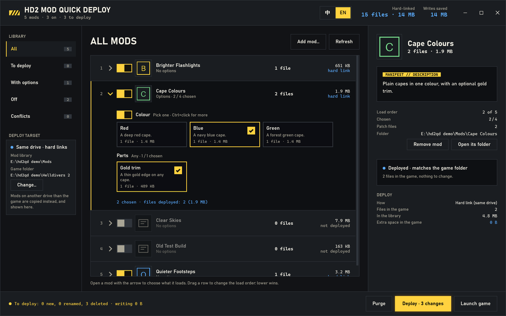
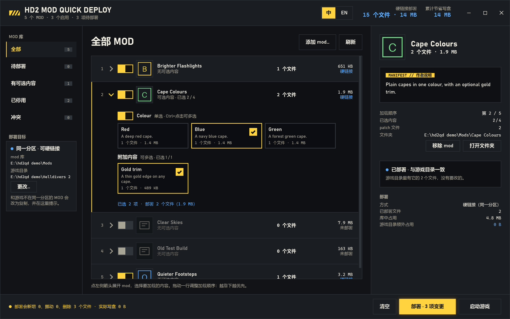

# HD2 Mod Quick Deploy

A mod manager for Helldivers 2 built around two things the usual managers do
not do:

- **Incremental deploys.** It never empties the game folder to copy everything
  back. It compares what the load order needs with what is in the game folder
  and touches only the files that differ.
- **Hard links.** A deployed file is the library's own file under a second
  name: nothing is copied, nothing is written, no space is taken twice.

So a typical deploy takes **under half a second** (0.13–0.29 s measured) and
writes **no mod data at all**: only file names and directory entries change,
plus a deploy record of about 100 KB. A purge-and-copy manager writes the whole
mod set every time.

It comes in two parts that share one library and one set of settings:

- **HD2 Mod Quick Deploy** — the window, for players;
- **hd2qd** — the command line, for mod makers and scripts.

[中文说明在下面](#中文)

## How much writing and time it saves

Measured on the author's library: 68 mods, 284 patch files, 2.84 GB in the
game folder, library and game on one NTFS drive.

| You change | A purge-and-copy manager writes | HD2 Mod Quick Deploy writes | Deploy time |
|---|---|---|---|
| Nothing | 2.84 GB | **0 B** | 0.13–0.18 s |
| One mod's version (a new zip) | 2.84 GB | **0 B** — 1 hard link, 1 delete | 0.14–0.29 s |
| A mod turned off | 2.84 GB | **0 B** — 109 renames, 69 deletes | 0.23 s |
| The same mod turned back on | 2.84 GB | **0 B** — 109 renames, 69 hard links | 0.23–0.25 s |
| A mod moved in the load order | 2.84 GB | **0 B** — 82 renames | 0.19–0.21 s |
| Space taken in the game folder | 2.84 GB of copies | **0 B** — hard links | |

"0 B" is mod data: renames, links and deletes still change a few KB of file
system entries, and each deploy saves its record (about 100 KB). The times
include starting `hd2qd.exe` (26 ms) and were taken with the files already in
Windows' cache; slower are the first deploy after Windows starts (not
measured), the first comparison of two large identical files (read once, then
remembered) and a new zip, which is unpacked once (0.58 s for a 55 MB zip).

Ten such changes in one session write 28 GB to the drive with
purge-and-copy, and only file entries here. The window counts it for you on its *Storage* page
(*Writes saved*): three deploys on that library saved 8.51 GB.

Coming from another manager: one click on *Make hard links* (or
`hd2qd relink`) turned its 284 copies into hard links in 2.5 s, writing
nothing and giving 2.84 GB back.

When the library is on another drive than the game, hard links are not
possible and changed files are copied; the deploy is still incremental, so
updating a 5 MB mod writes 5 MB, not 2.84 GB.

## How it does it

- a file that is already right is left alone;
- a mod moved in the load order, or renumbered because another was turned off,
  is **renamed**, not copied;
- a new file is a **hard link** to the library when both are on one drive (a
  copy otherwise);
- a file that is no longer wanted is deleted.

## Requirements

- Windows 10 (1903 or later) or Windows 11.
- Nothing to install: both programs need only the .NET Framework 4.8 that
  Windows comes with.

## The window

### The first start

1. Open `HD2 Mod Quick Deploy.exe`.
2. It finds the game folder by itself (from HD2 Arsenal's settings or Steam's
   library list). If it cannot, it asks for it: choose the game folder, its
   `data` or its `bin` folder.
3. If your library is empty, it lists the mod managers found on this computer
   (HD2 Arsenal, HD2ModManager, Echelon) and offers to import their lists: the mods,
   their order, on/off and options. Their files are only read, and a mod found
   in more than one is imported once.
4. Mods that are on another drive than the game are pointed out, with what
   moving them gives (see *Mod folders*). Nothing is moved unless you choose to.

### What is where

| Part | What it shows and does |
|---|---|
| Title bar | How many mods, how many are on, how many changes wait for a deploy; **Deploy / Storage / Labels** to switch pages; a gear for the settings (the language, whether the mod that wins is shown at the bottom of the list or at the top, whether the lines that explain things are shown, who made it and where it comes from); the hard-linked files in the game. |
| Library (left) | Filters: all mods, those with changes to deploy, Lua mods, off, with conflicts, and any that cannot be read. |
| Deploy target (left) | The library and game folders, and whether they share a drive (hard links) or not (copies). **Change…** picks another game folder. When the game holds copies that could be hard links, **Make hard links** frees their space without writing anything. |
| Filter (left of the search box) | Narrows the list to your own labels: a mod shows when it carries any of the labels ticked. Alt+click a label to hide the mods that carry it. |
| Search (above the list) | Finds mods by any word in their metadata, not only the name: the author's description, options and their descriptions, folders, patch file names (archive ids), Nexus mod ids, *lua*, *loader*, and your own labels. Several words: all must match. |
| Mod list (middle) | The load order, top to bottom: **a mod lower in the list wins**. Each row: its number, its switch, its picture, its name, and under the name its version, what is chosen, a **LUA** tag when it runs scripts in the game and a **LOADER** tag when it replaces one of the game's own scripts the way a mod loader does; on the right a mark that checks this one mod for updates, its size and how it is deployed. Dropping a zip or a mod folder on the list installs it. Double-click a mod to give it a name of your own (the name it came with stays in its details); Ctrl or Shift takes several mods at once, and the right button turns them all on or off, moves them or removes them. |
| Options (open a row with its arrow) | A mod's options as cards with their pictures, names and descriptions. A group is *pick one* (Ctrl+click for more); parts can each be on or off. |
| Labels page | Your own labels for mods, with how many mods carry each one: make one, rename it, delete it, and tick the mods that carry it. |
| Details (right) | The author's description (or, when the mod folder has none, what its site says), the load order, the folder, **Delete** (red), **Remove mod** and **Open its folder**; what the next deploy does to this mod (kept, renamed, new), its conflicts with other mods, the resources another mod ships byte for byte alike (shared, not fought over), and its source: **Match the source** asks the site what the mod is called and fills in its name, version, author, description and picture. |
| Footer | What a deploy would do; **Deploy** and **Launch game**. A deploy never needs a purge first: it changes only what differs. **Restore vanilla** is at the bottom of the deploy target card, for playing without mods. |

### Everyday use

1. **Add a mod**: drop its zip or folder on the list, or *Add mod…* → a zip or
   a folder. It goes to the bottom of the list, so it wins over the others.
2. **Turn it on or off** with its switch, and **choose its options** on its
   cards. Every click shows at once; the window works it out in the background.
3. **Change the load order** by dragging a row.
4. **Deploy**. The footer says what was kept, renamed, written and deleted, and
   how long it took.
5. **Launch game** starts the game through Steam. If changes are not deployed
   yet, it offers to deploy them first.

A new version of a mod: right-click it → *New version from a zip / a folder*.
It keeps its place in the list and its options.

**Remove mod** only takes a mod out of the library; its files stay where they
are. **Delete** (the red button, or right-click → *Delete from the disk…*)
takes it off the disk for good: out of the library, out of the game (a deploy
runs at once) and its folder deleted, not moved to the Recycle Bin. The zip it
was added from is kept. It refuses, changing nothing, while the game runs or
when the folder is not the mod's own (a drive, the game folder, or a folder
other mods in the library use).

### Mod folders (the Storage page)

The **Storage** page lists the folders that hold mods, as Steam lists its
library folders: each with its drive, free space, how many mods it holds and
their size, and whether it is on the game's drive.

- **Default**: added zips go there. *Make default* chooses
  another; *Add folder…* adds one; *Remove from list* takes a folder you added
  off the list (its files stay).
- Folders that mods are in are listed by themselves (HD2 Arsenal's, HD2ModManager's, Echelon's).
- **Moving mods**: choose a folder, tick its mods, *Move to…* another folder.
  *Move* deletes the old folders; *Copy* keeps them, for a manager that still
  uses them. Afterwards the window says how many were moved and where, and the
  game folder's copies of them become hard links.

**Mods on another drive than the game** are deployed as copies: they take
their space a second time and every change writes them again. The window
points this out, after an import or an added folder and at the top of the
Storage page, and handles each choice:

| You choose | What happens |
|---|---|
| Keep them where they are | Nothing is moved. They are deployed as copies, and that folder is not pointed out again. They can still be moved on the Storage page at any time. |
| Move | They are moved to the default folder when it is on the game's drive, else to `HD2 Mods` on the game's drive; the question names the folder. The old folders are deleted. |
| Copy | As Move, but the old folders stay (the mods then take space twice). |

### Update checks

**Check for updates** (above the list) checks every mod that came from a GitHub
repository:

| Source | How it is checked | How it is updated |
|---|---|---|
| GitHub | The repository's latest release. | **Update** downloads the release's zip, 7z or rar. |
| Nexus Mods, another site | Not checked. | **Open page**. |

- The source is recorded when a mod arrives: a file downloaded with a browser
  (Windows keeps the address it came from), or HD2 Arsenal's records for the
  mods it installed.
- When it is not recorded, the mod's details offer **Set source…**: paste the
  mod's Nexus Mods page or GitHub repository.
- Mods with updates get a yellow tag in the list and their own filter, **Updates**.
- An update keeps the mod's place in the load order, on/off and options; then
  deploy.

### Good to know

- **Use one manager for deploying.** A deploy from another manager would undo
  this one's, and the other way round.
- **Do not edit a deployed patch file in place**: as a hard link it is the same
  file as the library's, so the library would change too. Deleting one
  (*Restore vanilla*) does not touch the library.
- A deploy or *Restore vanilla* waits until the game is closed.
- The window's language is its own setting (in the settings window, kept for
  the next start); until one is chosen, it follows Windows.
- `HD2 Mod Quick Deploy.exe --select TEXT` opens the first mod whose name holds
  TEXT.
- **hd2qd can be run by an AI assistant.** Everything is kept in
  `%USERPROFILE%\.hd2-mod-cli`, not in AppData: a program started by a packaged
  app (most desktop AI assistants are) has a folder it makes under `%APPDATA%`
  put in that app's private copy, which no other program reads, and the library
  would split in two without any error. If `HD2MOD_HOME` points under AppData
  all the same, hd2qd checks before it writes and refuses, saying where the
  writes would have gone.

## The command line: hd2qd

The same library and the same deploy, for mod makers and scripts. Put
`hd2qd.exe` in a folder on your PATH, or type its full path.

    hd2qd init                 # finds the game (from HD2 Arsenal's settings or Steam)
    hd2qd import-arsenal       # optional: take HD2 Arsenal's mods, order, on/off and options
    hd2qd status               # what a deploy would change
    hd2qd deploy

A change made on the command line shows in an open window half a second later.

| Command | What it does |
|---|---|
| `init [--game DIR] [--mods-dir DIR]` | Set the game folder (found automatically when left out; the game folder, its `data` or its `bin`) and where zips are unpacked. |
| `import-arsenal [--file F] [--profile ID] [--replace]` | Add HD2 Arsenal's deployed profile to the library: names, folders, order, on/off, options; mods already in it are skipped (`--replace`: the library becomes HD2 Arsenal's). Mods stay in HD2 Arsenal's folders. |
| `list [--files] [--paths]` | The load order, top to bottom. The last one wins. `--files` shows each mod's patch files as they would be numbered. |
| `add PATH [--name N] [--copy]` | Add a mod at the bottom: a zip (unpacked once into the library folder) or a folder (used where it is, so a mod you are building can be deployed straight from its build folder). |
| `replace MOD PATH` | A new version of a mod: same place in the order, the same options by name. |
| `remove MOD` | Take a mod out of the library; its files stay. |
| `check-updates` | Check every mod from GitHub for a newer release. |
| `update MOD` | Download a mod's newer version from its GitHub releases and put it in its place. |
| `source MOD URL` / `source MOD --clear` | Set where a mod comes from: a Nexus Mods page, a GitHub repository or another page. |
| `import-hd2mm [--dir DIR] [--replace]` | Add HD2ModManager's mods, order, on/off and options to the library (read only; its folder-name and object options both). |
| `import-echelon [--file FILE] [--replace]` | Add Echelon's mods, on/off and options from its own library.json, in its active profile's order (read only). |
| `folders` | The mod folders: the default, the ones added, and the folders mods are in, with their drives. |
| `folder-add PATH` / `folder-remove PATH` / `folder-default PATH` | Add a mod folder, take one off the list (its files stay), choose the default. |
| `relocate MOD... --into FOLDER [--keep]` | Move mods into another mod folder (`--keep`: copy, the old folders stay); the game's copies of them become hard links. |
| `delete MOD --yes` | Delete a mod from the disk for good: out of the library and the game (a deploy), its folder deleted. |
| `enable MOD...` / `disable MOD...` | Turn mods on or off. |
| `move MOD --top / --bottom / --to N / --before M / --after M` | Change the load order. |
| `options MOD` | A mod's options and sub-options, numbered. |
| `set MOD OPTION on/off` | Turn an option on or off. `OPTION/SUB` or `2.3` for a sub-option; `--only` turns that sub-option on and the option's others off. |
| `status [--verify]` | What a deploy would change, file by file. Changes nothing. |
| `deploy [--dry-run] [--copy] [--verify]` | Make the game folder match the load order. |
| `relink [--dry-run]` | Make the copies in the game folder (another manager's, or `--copy`) hard links to the library, where both are on one drive: their space comes back and nothing is written. |
| `purge --yes` | Delete every patch file from the game folder: vanilla. The library keeps its files. |
| `which TEXT` | Which mod a patch file or archive comes from. |
| `rename MOD NAME` | Call a mod something else in the library; its folder and files are left alone. |
| `match MOD [--all]` | Ask a mod's GitHub repository what it is called and fill that in: name, version, author, description, picture. |
| `tags` | Your own labels, with how many mods carry each. |
| `tag MOD NAME...` / `untag MOD NAME...` | Put labels on a mod, or take them off (`--all` takes them all off). |
| `tag-rename OLD NEW` / `tag-delete NAME` | Rename a label everywhere, or take it off every mod. |
| `conflicts [-v]` | Resources that more than one mod ships, and which one wins; the ones every mod ships byte for byte alike are named as shared, not as a conflict. |
| `state [--verify]` | Everything the window shows, as JSON. |

`MOD` is the mod's number in `list`, its name, or a unique part of its name.

## How a deploy works

- **Numbering** is HD2 Arsenal's: mods from the top of the list to the bottom;
  inside a mod, its included folders in option order (an option's `Include`,
  then its enabled sub-options'); inside a folder, its patch files by their own
  number. Every archive counts from `patch_0` with no gaps, and each
  `.gpu_resources` / `.stream` file goes with its patch file. A mod without a
  manifest deploys its top folder, or, when that holds no patch file, every
  folder that does.
- **A file already right** is the same file (a hard link); else what the last
  deploy recorded for it, when neither file changed since; else the same bytes.
  Size and time alone are not trusted: a mod's option variants are often built
  in the same second with the same size. `--verify` compares bytes for every
  file.
- **Safety**: files are deleted, moved through temporary names, then linked or
  copied, so a name is never overwritten while another file still needs to
  move away from it.

## Files

Everything is kept in `%USERPROFILE%\.hd2-mod-cli` (`HD2MOD_HOME` overrides it):

| File | What it holds |
|---|---|
| `config.json` | The game folder and where zips are unpacked. |
| `library.json` | The mods, their order, on/off and options, and where each came from (for update checks). |
| `deployed.json` | What the last deploy put in the game folder. |
| `same.json` | Large files already compared, so they are not read again. |
| `gui.json` | The window's own settings (its language, which way the list is shown, the explaining lines). |
| `*.json.bak` | The version each file had before the last save. Mods can be downloaded again; what you chose — the mods, their order, their options, their labels — cannot, and it is a few kilobytes. To go back, rename the `.bak` over the file. |

The **default mod folder** (where added zips are unpacked, each as its own
folder; the archives are not kept) is not in AppData. It is
the one you set (*Make default* on the Storage page, or `folder-default`); until then HD2
Arsenal's mod folder when it is installed, else `HD2 Mods` on the game's drive,
so that deploys can use hard links.

## Building and tests

`build.bat` runs the tests, then builds both programs into `release\`. It needs
the .NET SDK 8 or later (`dotnet` on PATH, or set `DOTNET` to its
`dotnet.exe`).

| Folder | What it is |
|---|---|
| `core\` | Everything a command does, shared by both programs. |
| `cli\` | The command line, `hd2qd.exe`. |
| `gui\QuickDeploy\` | The window (WPF). |
| `tests\` | xUnit tests against a fake game folder in `%TEMP%`. |

Versions up to 0.1 were a Python script, kept at the git tag `python-0.1`; up
to 0.2 the command was called `hd2mod`. The settings files are the same, so
nothing needs migrating.

## License

MIT, see [LICENSE](LICENSE).

## 中文

Helldivers 2 的 mod 管理器，具备两项一般管理器所没有的特性：

- **增量部署**：不会在每次部署时先清空游戏目录、再全部复制回去，而是对比加载顺序所需的文件与游戏目录中已有的文件，仅处理有差别的文件。
- **硬链接**：部署到游戏目录的文件即 mod 库中的同一文件，仅多一个文件名。不复制、不写入数据，也不重复占用硬盘空间。

因此，一次典型的部署**不到半秒**（实测 0.13–0.29 秒），且**不写入任何 mod 数据**：仅更改文件名和目录项，另写入约 100 KB 的部署记录。“清空再全部复制”的管理器则每次都需重新写入整套 mod。

本程序分为两部分，共用同一个 mod 库和同一份设置：

- **HD2 Mod Quick Deploy**：图形界面，面向玩家；
- **hd2qd**：命令行，面向 mod 作者和脚本。

### 写盘量与用时

以下为作者 mod 库的实测结果：68 个 mod、284 个 patch 文件，游戏目录中共 2.84 GB，mod 库与游戏位于同一 NTFS 分区。

| 操作 | “清空再全部复制”的写盘量 | HD2 Mod Quick Deploy 写盘量 | 部署用时 |
|---|---|---|---|
| 无改动 | 2.84 GB | **0 B** | 0.13–0.18 秒 |
| 更新一个 mod 的版本（新 zip） | 2.84 GB | **0 B**：新增 1 个硬链接，删除 1 个文件 | 0.14–0.29 秒 |
| 停用一个 mod | 2.84 GB | **0 B**：重命名 109 个，删除 69 个 | 0.23 秒 |
| 重新启用该 mod | 2.84 GB | **0 B**：重命名 109 个，新增 69 个硬链接 | 0.23–0.25 秒 |
| 调整一个 mod 的加载顺序 | 2.84 GB | **0 B**：重命名 82 个 | 0.19–0.21 秒 |
| 游戏目录额外占用空间 | 2.84 GB 复制件 | **0 B**：硬链接 | |

“0 B”指 mod 数据：重命名、建立硬链接和删除仍会改动几 KB 的文件系统目录项，每次部署另写入约 100 KB 的部署记录。用时包括启动 `hd2qd.exe` 的 26 毫秒，测量时文件已在 Windows 缓存中。以下情况会稍慢：开机后的首次部署（未实测）；首次比较两个内容相同的大文件（仅读取一次，结果会被记录）；新 zip 需先解压一次（55 MB 的 zip 用时 0.58 秒）。

连续调整十次，“清空再复制”需向硬盘写入 28 GB，本程序仅更改目录项。“存储”页面的“累计节省写盘”会统计节省量：在上述 mod 库上部署三次，共节省 8.51 GB。

从其他管理器迁移时，点击“改为硬链接”（或运行 `hd2qd relink`），可将原有的 284 个复制件改为硬链接：用时 2.5 秒，不写入数据，释放 2.84 GB 空间。

mod 库与游戏不在同一分区时无法使用硬链接，有变化的文件将被复制，但部署仍为增量：更新一个 5 MB 的 mod 只写入 5 MB，而非 2.84 GB。

### 实现方式

- 已正确的文件保持不变；
- 调整加载顺序，或因停用某个 mod 导致后续文件重新编号时，仅重命名，不复制；
- mod 库与游戏位于同一分区时，新文件以硬链接放入（不同分区时复制）；
- 仅删除不再需要的文件。

### 运行要求

- Windows 10（1903 及以上）或 Windows 11；
- 无需安装其他组件，使用系统自带的 .NET Framework 4.8。

### 首次启动

1. 打开 `HD2 Mod Quick Deploy.exe`。
2. 程序会自动查找游戏目录（依据 HD2 Arsenal 的设置或 Steam 的库列表）；未找到时会提示选择，可选择游戏目录本身或其中的 `data`、`bin` 文件夹。
3. mod 库为空时，程序列出在本机找到的 mod 管理器（HD2 Arsenal、HD2ModManager、Echelon），询问是否导入其列表（mod、加载顺序、开关、可选内容）。导入仅读取其文件；同一个 mod 只导入一次。
4. 与游戏不在同一分区的 mod 会被提示，并说明移动的好处（见“MOD 库文件夹”）。未经选择不会移动任何文件。
5. 首次启动时会提示：安装 mod 无需先清空。

### 界面说明

| 位置 | 内容与功能 |
|---|---|
| 标题栏 | mod 数、启用数、待部署的变更数；**部署 / 存储 / 标签** 切换页面；齿轮按钮打开设置（界面语言、列表中优先的 mod 显示在下方还是上方、是否显示说明文字、作者与项目地址）；游戏目录中的硬链接文件 |
| 左侧 · MOD 库 | 筛选：全部、待部署、Lua mod、已停用、冲突、读取出错 |
| 左侧 · 部署目标 | mod 库与游戏目录，以及二者是否位于同一分区（硬链接）或不同分区（复制）。**更改…** 用于更换游戏目录；游戏目录中存在可改为硬链接的复制件时，**改为硬链接** 可在不写入数据的情况下释放空间。卡片底部为 **恢复原版** |
| 筛选（搜索框左侧） | 按自己贴的标签过滤：mod 带有任一所选标签即显示。按住 Alt 键点击标签，可隐藏带有该标签的 MOD |
| 搜索（列表上方） | 按元数据中的任意词查找 mod，不限于名称：作者说明、可选内容及其说明、文件夹、patch 文件名（档案编号）、Nexus 编号、*lua*。输入多个词时须全部匹配 |
| 中间 · mod 列表 | 加载顺序自上而下，**越靠下优先级越高**。每行显示：序号、开关、图片、名称，名称下方为版本、已选内容、**LUA** 标签（会在游戏中运行脚本的 mod）与 **LOADER** 标签（替换了游戏自带脚本、相当于自带加载器的 mod）；右侧为单独检查该 mod 更新的图标、大小与部署方式。将 zip 压缩包或 mod 文件夹拖到列表上即可安装。双击 mod 可自定义名称（原名保留在详情中）；按住 Ctrl 或 Shift 可多选，右键可一起启用、停用、移动或移除 |
| 可选内容（点击行左侧箭头展开） | 以卡片显示图片、名称和作者说明。一组内为单选（Ctrl+点击可多选）；附加内容可分别开关 |
| 标签页 | 自己给 mod 贴的标签，显示每个标签上有多少 mod：新建、重命名、删除，并勾选属于该标签的 mod |
| 右侧 · 详情 | 作者说明（mod 文件夹中没有说明时，显示来源网站的说明）、加载顺序、文件夹，以及 **删除**（红色外框）、**移除 mod**、**打开文件夹**；下次部署对该 mod 的处理（保留、重命名、新增），与其他 mod 的资源冲突，以及与其他 mod 内容完全相同的资源（属于共用，不算冲突），以及来源：点击 **匹配来源信息** 可从网站取回该 mod 的名称、版本、作者、说明和图片 |
| 底部 | 部署将执行的操作；**部署**、**启动游戏**。部署前无需清空，部署只处理有差别的文件 |

### 日常使用

1. **添加 mod**：将 zip 压缩包或 mod 文件夹拖到列表上，或点击“添加 mod…”选择 zip 或文件夹。新 mod 位于列表底部，优先级最高。
2. **启用或停用 mod、选择可选内容**：点击开关或卡片。界面立即更新，计算在后台完成。
3. **调整加载顺序**：拖动行。
4. **部署**：底部显示保留、重命名、新增、删除的文件数及用时。
5. **启动游戏**：通过 Steam 启动；存在未部署的变更时，会询问是否先部署。

更新 mod 版本：右键该 mod，选择“换新版本（zip）”或“换新版本（文件夹）”，加载顺序和可选内容保持不变。

**移除 mod** 仅将其从库中移除，文件保留在原处。**删除**（红色外框按钮，或右键选择“从硬盘删除…”）会将其从硬盘上彻底移除：从库中移除、立即部署一次以将其移出游戏目录，并永久删除其文件夹（不进入回收站）。添加时使用的 zip 不会删除。游戏运行时，或文件夹并非该 mod 自身的文件夹（盘符、游戏目录、库中其他 mod 也在使用的文件夹）时，删除将被拒绝，且不做任何更改。

### MOD 库文件夹（存储页）

**存储** 页按照 Steam 游戏库文件夹的方式列出存放 mod 的文件夹，每个文件夹显示所在分区、可用空间、其中的 mod 数量与大小，以及是否与游戏位于同一分区。

- **默认文件夹**：添加的 zip 放入此处。“设为默认”可更换默认文件夹；“添加文件夹…”可添加文件夹；“从列表移除”仅将添加的文件夹移出列表，其中的文件保留。
- 含有 mod 的文件夹会自动列出（如 HD2 Arsenal、HD2ModManager、Echelon 的文件夹）。
- **移动 mod**：选择文件夹，勾选其中的 mod，点击“移动到…”并选择目标文件夹。“移动”将删除原文件夹；“复制”保留原文件夹，供仍在使用的其他管理器使用。完成后程序会说明移动的数量与位置，并将游戏目录中对应的复制件改为硬链接。

**与游戏不在同一分区的 mod** 只能以复制方式部署：额外占用一份空间，每次变更都需重新写入。程序会在导入或添加文件夹后、以及存储页顶部提示此情况，并按选择处理：

| 选择 | 结果 |
|---|---|
| 保持现有位置 | 不移动任何文件，以复制方式部署，此文件夹不再提示。之后仍可随时在存储页移动。 |
| 移动 | 移动到默认文件夹（位于游戏所在分区时），否则移动到游戏所在分区的 `HD2 Mods`；提示中会写明目标文件夹。原文件夹删除。 |
| 复制 | 与“移动”相同，但保留原文件夹（mod 将占用两份空间）。 |

### 检查更新

点击列表上方的 **检查更新**，程序将检查来自 GitHub 仓库的 mod 是否有新版本：

| 来源 | 检查方式 | 更新方式 |
|---|---|---|
| GitHub | 仓库的最新发布版本（Release）。 | 点击 **更新** 下载该版本的 zip、7z 或 rar。 |
| Nexus Mods、其他网站 | 不检查。 | 点击 **打开页面** 查看。 |

- mod 的来源在加入时自动记录：用浏览器下载的文件（Windows 会保存下载地址），以及 HD2 Arsenal 为其安装的 mod 保存的记录。
- 未记录来源的 mod，可在详情中点击 **设置来源…**，填写该 mod 的 Nexus Mods 页面或 GitHub 仓库地址。
- 有更新的 mod 在列表中显示黄色标记，并可通过 **有更新** 筛选查看。
- 更新后，mod 的加载顺序、开关和可选内容保持不变；之后执行部署即可生效。

### 注意事项

- **请仅使用一个管理器部署。** 使用其他管理器部署会覆盖本程序的部署，反之亦然。
- **请勿直接修改游戏目录中已部署的 patch 文件**：硬链接与 mod 库中的文件为同一文件，修改会同时影响 mod 库。恢复原版不影响 mod 库。
- 游戏运行时无法部署或恢复原版。
- 界面语言为本程序独立的设置（设置窗口中选择，下次启动时保留）；未设置时跟随 Windows 的语言。
- **hd2qd 可以由 AI 助手调用。** 所有数据保存在 `%USERPROFILE%\.hd2-mod-cli`，而不是 AppData：由打包应用（多数桌面版 AI 助手都是）启动的程序，在 `%APPDATA%` 下新建的文件夹会被 Windows 放进该应用的私有目录，其他程序都读不到，mod 库会在没有任何报错的情况下分成两份。如果仍将 `HD2MOD_HOME` 设在 AppData 下，hd2qd 会在写入前检查，并拒绝执行、说明写入本会落在何处。

### 命令行 hd2qd

    hd2qd init
    hd2qd import-arsenal     # 仅读取 HD2 Arsenal 的数据，将其 mod、加载顺序、开关和可选内容加入库中
    hd2qd import-hd2mm       # 同上，来源为 HD2ModManager
    hd2qd import-echelon     # 同上，来源为 Echelon
    hd2qd folders            # 列出 mod 库文件夹
    hd2qd status             # 显示部署将执行的更改，不做修改
    hd2qd check-updates      # 检查来自 GitHub 的 mod 是否有新版本
    hd2qd deploy

完整命令列表见英文部分的表格。设置与记录保存在 `%USERPROFILE%\.hd2-mod-cli`。每个文件保存时会把上一版留为同名的 `.bak`：mod 可以重新下载，而你的选择（哪些 mod、顺序、可选内容、标签）不能，且只有几十 KB。需要回退时，把 `.bak` 改名覆盖原文件即可。

**默认 mod 库文件夹**（添加的 zip 解压为此处的文件夹，不保留压缩包）不位于 AppData：优先使用已设置的文件夹（存储页的“设为默认”，或 `folder-default`）；未设置时使用 HD2 Arsenal 的 mod 文件夹；未安装 HD2 Arsenal 时使用游戏所在分区的 `HD2 Mods`，以便部署时使用硬链接。
